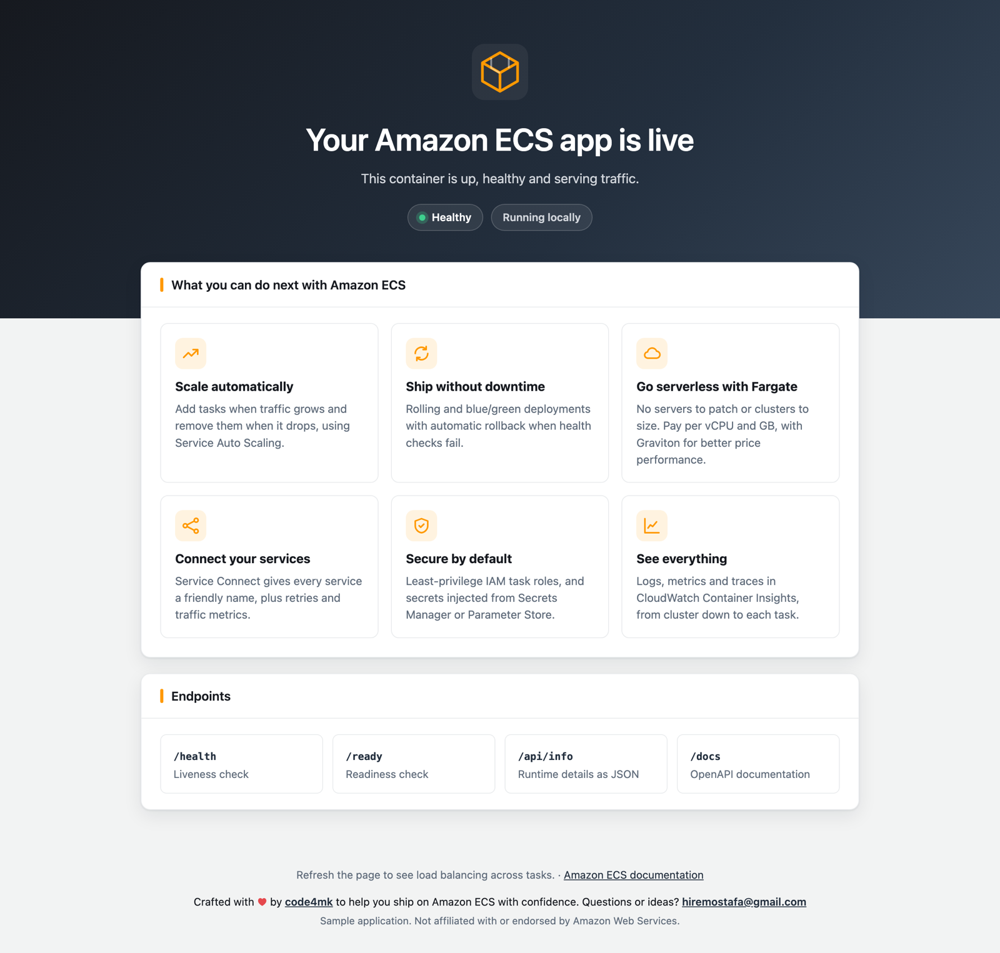

# aws-ecs-helloworld

[](https://hub.docker.com/r/hiremostafa/aws-ecs-helloworld)

A production-ready Hello World container for **Amazon ECS**. Deploy it to verify a cluster,
service, load balancer and health checks end to end, before shipping your real application.

```text
hiremostafa/aws-ecs-helloworld:latest
```



## Features

- FastAPI + uvicorn, plain HTML home page (no JavaScript, strict CSP)
- `/health` (liveness) and `/ready` (readiness) endpoints, plus a curl-free container health check
- Detects ECS and exposes live task metadata (cluster, service, task, AZ, private IP, image) at `/api/info`
- Structured JSON logs for CloudWatch, request IDs, security headers
- Non-root (UID 10001), slim image, graceful shutdown on `SIGTERM`

## Quick start

```bash
docker run --rm -p 8080:8080 hiremostafa/aws-ecs-helloworld:latest
```

Open http://localhost:8080

## Deploy to Amazon ECS

Use the public image directly; no build needed.

| Setting              | Value                                               |
| -------------------- | --------------------------------------------------- |
| Image                | `hiremostafa/aws-ecs-helloworld:1.0.0`              |
| CPU architecture     | `X86_64` (the published image is `linux/amd64`)     |
| Container port       | `8080`                                              |
| ALB target group     | protocol `HTTP`, port `8080`, target type `ip`      |
| ALB health check     | path `/health`                                      |

Container definition snippet for your task definition:

```json
{
  "name": "web",
  "image": "hiremostafa/aws-ecs-helloworld:1.0.0",
  "essential": true,
  "portMappings": [{ "containerPort": 8080, "protocol": "tcp" }],
  "healthCheck": {
    "command": ["CMD", "python", "-m", "app.healthcheck"],
    "interval": 30,
    "timeout": 5,
    "retries": 3,
    "startPeriod": 10
  }
}
```

On Fargate, set `"runtimePlatform": { "cpuArchitecture": "X86_64", "operatingSystemFamily": "LINUX" }`
in the task definition. The container listens on **8080** because it runs as a non-root user.

## Endpoints

| Path        | Purpose                                                           |
| ----------- | ----------------------------------------------------------------- |
| `/`         | HTML home page                                                    |
| `/health`   | Liveness. Use for the ALB target group and container health check |
| `/ready`    | Readiness. Returns `503` during startup and shutdown              |
| `/api/info` | App, runtime and ECS metadata as JSON                             |
| `/docs`     | OpenAPI UI                                                        |

## Configuration

| Variable                    | Default                       |
| --------------------------- | ----------------------------- |
| `PORT`                      | `8080`                        |
| `MESSAGE`                   | `Your Amazon ECS app is live` |
| `APP_NAME`                  | `aws-ecs-helloworld`          |
| `LOG_LEVEL`                 | `info`                        |
| `LOG_HEALTH_CHECKS`         | `false`                       |
| `ECS_METADATA_TIMEOUT`      | `2` (seconds)                 |
| `GRACEFUL_SHUTDOWN_TIMEOUT` | `20` (seconds)                |

Example: `docker run --rm -p 8080:8080 -e MESSAGE="Hello from my cluster" hiremostafa/aws-ecs-helloworld`

## Tags

| Tag      | Platform      |
| -------- | ------------- |
| `latest` | `linux/amd64` |
| `1.0.0`  | `linux/amd64` |

## Build from source

```bash
docker build -t aws-ecs-helloworld .
docker run --rm -p 8080:8080 aws-ecs-helloworld
```

For Graviton (ARM64), build your own image with
`docker buildx build --platform linux/arm64 -t <your-registry>/aws-ecs-helloworld --push .`

## Development

```bash
python -m venv .venv && .venv/bin/pip install -r requirements-dev.txt
.venv/bin/pytest
.venv/bin/python -m app
```

## Author

Crafted with ♥ by [code4mk](https://github.com/code4mk). Questions, ideas or work inquiries: [hiremostafa@gmail.com](mailto:hiremostafa@gmail.com)
